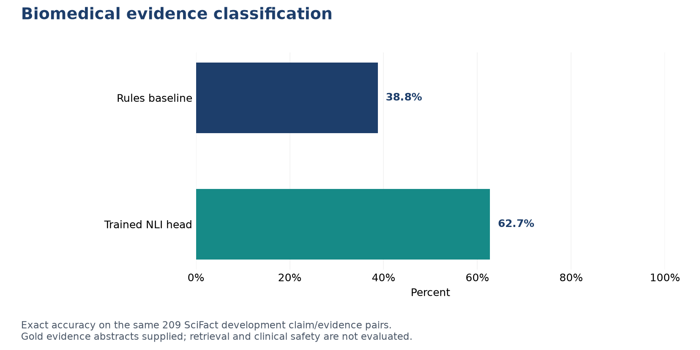

# Biomedical RAG Evidence Validator

**Project by Giacomo Albergo** | Independent portfolio project | October 2026

An evidence-auditing prototype for biomedical RAG answers. It decomposes answers into claims, checks cited abstracts and reports structured verification outcomes, with explicit human review safeguards.

**Technology:** Python, FastAPI, Transformers, scikit-learn

## What this demonstrates

- Compared deterministic biomedical rules with a frozen DeBERTa NLI encoder and a lightweight supervised head.
- Trained on 894 official SciFact training pairs; selected among eight head configurations using three grouped cross-validation folds, keeping connected claim/document groups together.
- Separated evidence selection from gold rationale annotations; reported no-evidence cases, matched baselines and claim-cluster bootstrap uncertainty.
- Implemented configurable FastAPI validation and citation matching, with uncalibrated scores and a fail-closed safety flag.

## Evaluation

| SciFact development evaluation | Pairs | Rules accuracy | Trained classifier accuracy |
| --- | ---: | ---: | ---: |
| Gold evidence abstracts supplied | 209 | 38.8% | **62.7%** |
| Including cited documents for no-evidence claims | 323 | 55.7% | **67.8%** |

The original-subset accuracy gain is 23.9 percentage points; its paired claim-cluster bootstrap 95% interval is 13.6 to 34.0 points. Macro F1 is 0.689 over support/refute on the original subset and 0.670 over three labels on the expanded set. A zero-shot pretrained pilot produced little exact-accuracy improvement, motivating the supervised training head.

The [aggregate metrics](results/metrics.json) contain the values behind this figure. The findings describe the stated dataset, split and evaluation protocol.

## Scope and limitations

- This is a development-split audit; it is not a hidden-test estimate or clinical validation.
- Gold evidence documents are supplied for support/refute examples, so document retrieval is not evaluated.
- The expanded set has a different denominator and includes NEI examples; it cannot be compared directly with the original 209-pair accuracy.
- The API does not certify medical safety. Detailed hallucination taxonomy and resolution of conflicting papers remain outside the NLI evaluation.

## Portfolio access

This repository shares the project overview, methodology, aggregate results and figures. The implementation, training/inference code, model artifacts and full development history are maintained in a separate private repository. Access for a technical review can be discussed through [my GitHub profile](https://github.com/ZioJack99).

See [data and method sources](DATA_SOURCES.md) and [rights and attribution](RIGHTS.md). This is a portfolio showcase, not an open-source software release.
